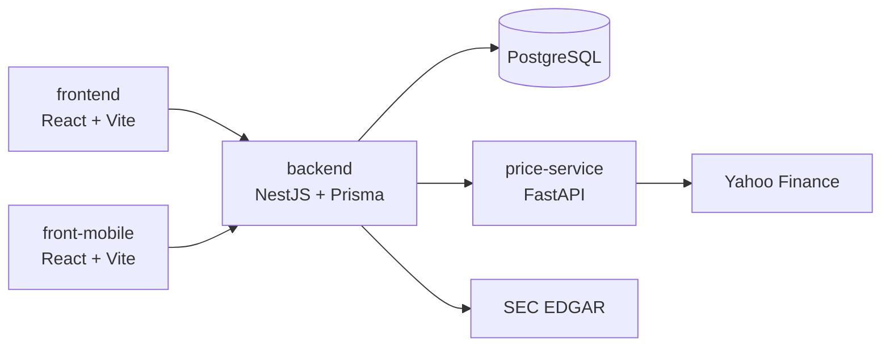

<p align="center">
  
</p>

<h1 align="center">Bovelez</h1>

<p align="center">
  Stock portfolio tracker backed by official SEC data and live market prices.
</p>

---

Users sign up, buy and sell stocks, and follow their portfolio with live prices and daily P&L. Every ticker is
validated against **SEC EDGAR**, and each company page shows its latest 10-K/10-Q filings and quarterly financials
(revenue, net income, EPS, assets, liabilities).

## Features

- **Buy / sell stocks**: tickers are validated against EDGAR, and you can't sell more than you hold.
- **Portfolio & dashboard**: open positions, average cost and P&L. Positions have no table of their own: they're
  computed by replaying the user's transactions (FIFO average cost), so the transaction log is the single source of
  truth.
- **Live prices**: the S&P 500 is seeded on startup and refreshed hourly from Yahoo Finance through a dedicated
  `price-service`, with daily % change.
- **Company detail**: EDGAR company data, recent filings with links to the documents, and quarterly metrics.
- **Watchlist & compare**: follow up to 20 companies and compare their last four quarters side by side.
- **Web and mobile front-ends**, both talking to the same API.

## Architecture



| Component | Stack | Role |
| --- | --- | --- |
| `backend/` | NestJS, Prisma, PostgreSQL | REST API, JWT auth (argon2id password hashing), 24 h cache over EDGAR |
| `price-service/` | Python, FastAPI | Fetches prices from Yahoo Finance |
| `frontend/` | React, TypeScript, Vite | Web app |
| `front-mobile/` | React, TypeScript, Vite | Mobile app |

Backend modules follow `controller → service → repository`, with each repository behind an interface so it can be
swapped for a mock in tests. A global JWT guard protects every route by default; public routes opt out explicitly.

## Quality

| What | How |
| --- | --- |
| Unit + integration tests | Jest; integration tests run against a dedicated Postgres in Docker |
| Web E2E | Cypress against the full stack in Docker Compose (`./e2e.sh`) |
| Mobile E2E | Appium on an Android emulator (`./e2e-mobile.sh`) |
| Load & stress | Locust with three realistic user flows, run under different CPU/memory limits. A shared token bucket keeps traffic under EDGAR's 10 req/s rate limit. See [`locust-testing/`](locust-testing/) |
| CI/CD | GitHub Actions: tests on every PR, automated releases with `semantic-release`, Docker images published to GHCR |

## Run it locally

Run the full development stack from the repository root:

```bash
docker compose up --build
```

The web app runs at http://localhost:5173 and the API runs at http://localhost:8080.

The frontend reads `VITE_API_URL` as its browser-facing API base URL. In Docker development it defaults to `/api`,
and Vite proxies those requests to the backend service through `VITE_API_PROXY_TARGET`.

To override the API URL:

```bash
VITE_API_URL=http://localhost:8080 docker compose up --build frontend
```

## Releases

Releases are automated with `semantic-release` from commits merged into `main`.
Use Conventional Commits so the CI release job can calculate the next version:

- `fix: ...` creates a patch release, for example `1.2.3` -> `1.2.4`.
- `feat: ...` creates a minor release, for example `1.2.3` -> `1.3.0`.
- `feat!: ...`, `fix!: ...`, or a commit body containing `BREAKING CHANGE:` creates a major release, for example
  `1.2.3` -> `2.0.0`.

The release workflow updates `backend/package.json`, `frontend/package.json`,
their lockfiles, `CHANGELOG.md`, creates a `vX.Y.Z` tag, and publishes a GitHub
release. To preview the next version locally, run:

```bash
npm run release:dry-run
```

## Team

Built by a team of five as a university project at Universidad Austral.
